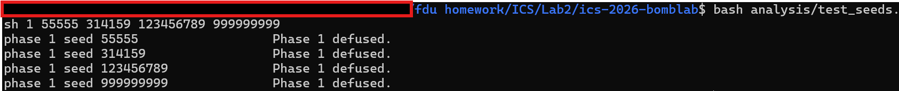
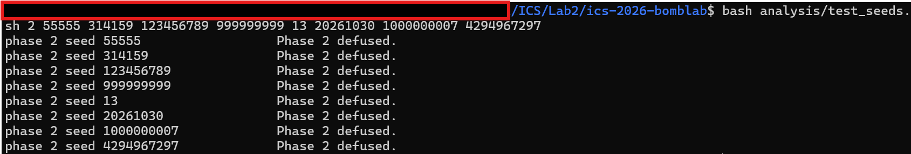
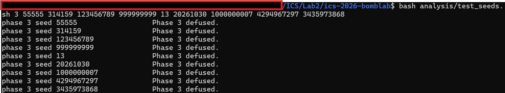
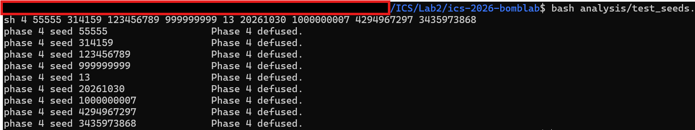
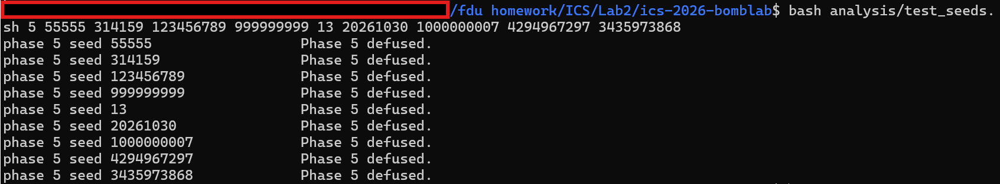
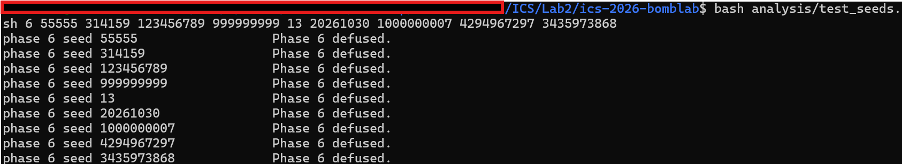
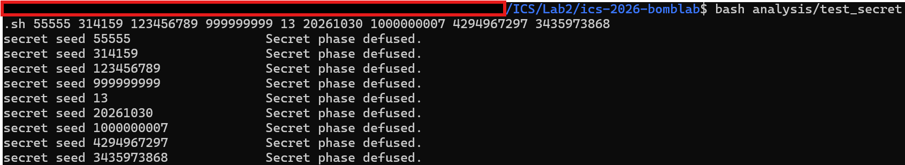

# ICS Lab2: BombLab 实验报告


## 0. 实验概况

- 环境：WSL Ubuntu + gcc + objdump + gdb
- 完成情况：第 1~6 关全部通过；Honor（Secret）通过
- 最终自测：`python3 public_test.py` → 六关 60/60，Honor 10/10

### 使用的辅助工具

- 使用objdump导出反汇编
- 使用gdb进行dump关键数据
- 使用deepseek协助测试以及规范报告的markdown

## 1. 第 1 关：函数调用、参数传递、返回值

### 关键汇编（`phase_01` / `p1_compute`）

```
phase_01:
  mov    $0x1,%esi
  call   valid_u32_fields          ; 口令 = 1 个整数
  lea    -0x14(%rbp),%rdx
  mov    $0x403189,%esi            ; "%u"
  call   sscanf
  cmp    $0x1,%eax
  ...
  mov    %r12,%rdi                 ; rdi = challenge
  call   p1_compute
  cmp    %eax,-0x14(%rbp)          ; 输入 == p1_compute(challenge)
  sete   %al
```

`p1_compute` 内部依次调用 `p1_step1`、`p1_step0`、`p1_step2`。

### 恢复出的计算关系

记 `A=(uint32_t)(challenge>>32)`、`B=(uint32_t)(challenge>>16)`、`C=(uint32_t)challenge`：

```
t1  = (3*A) ^ (B + 0x9f7f)         ; p1_step1
t0  = 3*(C - A) + 0x74e0           ; p1_step0
out = (3*t0 + t1) ^ 0xd64f         ; p1_step2
```

### 推理过程

（运用记事本）逐行记录寄存器的值，根据指令进行计算，最后查看%rax的值作为values[0]，其中count的值由scanf后的比较进行推断。

### 验证

- 公开 seed（0,1,7,42,99,123,2026,65535,987654321,18446744073709551615）：全部 `Phase 1 defused.`
- 公开列表外 seed：55555、314159、123456789、999999999、13、20261030、1000000007 均通过

运行截图：



## 2. 第 2 关：数组、循环、递推

### 关键汇编（`phase_02`）

```
mov    $0x6,%esi
call   valid_u32_fields            ; 6 个整数
mov    $0x40317a,%esi              ; "%u %u %u %u %u %u"
...
shr    $0x2b,%rdx ; add %edx,%edx ; and $0x3e,%edx ; add $0x16,%edx
cmp    %edx,%eax                   ; values[0] == 2*((ch>>43)&0x1f)+0x16
...
402170: mov $0x9,%ecx              ; 移位量 cl 初值 9
402175: mov $0x1,%edx              ; i = 1
40217a: add %edx,%eax              ; eax = values[i-1] + i
40217f: shr %cl,%rdi               ; (challenge >> cl)
402182: lea (%rax,%rax,4),%eax     ; rax*5
402185: and $0x3f,%edi
402188: sub %edi,%eax
40218c: mov -0x40(%rbp,%rdx,4),%eax
402194: add $0x1,%rdx
402198: add $0x4,%ecx
40219b: cmp $0x6,%rdx
40219f: jne 40217a
```

### 恢复出的计算关系

```
values[0] = 2*((challenge>>43) & 0x1f) + 0x16
values[i] = 5*(values[i-1] + i) - ((challenge >> (5 + 4*i)) & 0x3f)   (i = 1..5)
```

### 推理过程

发现 40219f 的 `jne` 跳回 40217a，402194 每次把 `rdx` 加 1，40219b 用 `rdx` 与 `6` 比较决定是否回跳 → 循环体执行 5 次（`rdx=1..5`），连同循环前算出的 `values[0]` 共 6 个数。40218c 用 `rdx` 作数组下标取 `values[i]`，40217f 用 `cl` 作移位量；进入本次循环体时 `eax` 是上一轮的 `values[i-1]`，所以每一轮都在前一个结果上递推。

### 验证

- 公开 seed：10/10
- 公开列表外 seed：55555、314159、123456789、999999999、13、20261030、1000000007、4294967297 均通过

运行截图：



## 3. 第 3 关：switch 分支与跳转表

### 关键汇编（`phase_03` / `p3_dispatch`）

```
mov    $0x2,%esi
call   valid_u32_fields            ; 2 个整数，"%u %u"
...
mov    %r12d,%edi ; and $0x7,%edi
cmp    %edi,-0x18(%rbp)            ; values[0] == challenge & 7
...
shr    $0x3,%rax ; shr $0x20,%rsi ; xor %eax,%esi
call   p3_dispatch                 ; p3_dispatch(values[0], b)
cmp    %eax,-0x14(%rbp)            ; values[1] == 返回值

p3_dispatch:
  mov %edi,%eax ; mov %esi,%edi
  cmp $0x7,%eax
  ja  default
  notrack jmp *0x405820(,%rax,8)
```

跳转表 `0x405820` 共 8 项，映射到 `p3_case_N`。

### 恢复出的计算关系

```
values[0] = challenge & 7
b         = (uint32_t)(challenge>>32) ^ (uint32_t)(challenge>>3)
values[1] = p3_dispatch(values[0], b)
```

`p3_dispatch` 的 8 个分支（参数 `b`）：

| idx | case | 返回 |
| --- | --- | --- |
| 0 | case_2 | `5*b + 0xed2b` |
| 1 | case_5 | `5*b + 0x424cd` |
| 2 | case_7 | `5*b + 0xd218` |
| 3 | case_3 | `(b ^ 0x5c43) + (b>>1)` |
| 4 | case_4 | `(b ^ 0x1491) + (b>>2)` |
| 5 | case_0 | `(4*b) ^ 0xa169` |
| 6 | case_6 | `(4*b) ^ 0x4990` |
| 7 | case_1 | `3*b + 0x2fd7` |
| >7 | default | `0` |

### 推理过程

- 根据40226d运用gdb找到表，推测这一行是在根据rax中的值进行跳转。根据表项的地址对应的case以及命名方式，推测使用switch进行选择，然后逐case编写对应代码。

### 验证

- 公开 seed：10/10
- 公开列表外 seed：55555、314159、123456789、999999999、13、20261030、1000000007、4294967297、34359738368 均通过

运行截图：



## 4. 第 4 关：递归与返回过程

### 关键汇编（`phase_04` / `p4_walk`）

```
; 入口参数
mov %r12d,%edi ; and $0x7f,%edi          ; a = challenge & 0x7f
xor %esi,%esi                            ; lo = 0
mov $0x7f,%edx                           ; hi = 127
shr $0x7,%rcx ; shr $0x20,%rax ; xor %eax,%ecx   ; d
call p4_walk

p4_walk:
  mov %edi,%eax ; mov %edx,%edi ; sub %esi,%edi
  shr $1,%edi ; add %esi,%edi            ; mid = lo + ((hi-lo)>>1)
  cmp %eax,%edi ; je base
  lea (%rdi,%rcx,1),%ebx                 ; ebx = mid + d
  cmp %edi,%eax ; jb left                ; a < mid -> 左
  ; 右：lo = mid+1
  call p4_walk ; lea (%rax,%rax,4),%eax  ; *5
  xor %ebx,%eax ; ... ; xor $0x10,%eax
  ; 左：hi = mid-1
  call p4_walk ; lea (%rax,%rax,4),%eax
  xor %ebx,%eax ; ... ; xor $0xe,%eax
base:
  lea 0x86(%rdi),%eax ; xor %ecx,%eax
```

### 恢复出的计算关系

```
walk(a, lo, hi, d):
    mid = lo + ((hi - lo) >> 1)
    if a == mid: return (mid + 0x86) ^ d
    if a > mid:  r = walk(a, mid+1, hi, d); return ((5*r) ^ (mid+d)) ^ 0x10
    else:        r = walk(a, lo, mid-1, d); return ((5*r) ^ (mid+d)) ^ 0xe

values[0] = walk(challenge & 0x7f, 0, 0x7f,
                 (uint32_t)(challenge>>7) ^ (uint32_t)(challenge>>32))
```

### 推理过程

- 注意到402367调用p4walk，而自己本身就是p4walk，推测这段是一个递归代码。注意到它用到了rdi、rsi、rdx、rcx四个寄存器的值，说明这个递归需要四个参数。然后根据汇编指令填入递归的框架。

### 验证

- 公开 seed：10/10
- 公开列表外 seed：55555、314159、123456789、999999999、13、20261030、1000000007、4294967297、34359738368 均通过

运行截图：



## 5. 第 5 关：结构体布局、指针、链表遍历

### 节点布局（每个 16 字节）

```c
struct node { struct node *next; /* +0 */ uint32_t a1; /* +8 */ uint32_t a2; /* +12 */ };
```

头表 `p5_heads`（`0x405b60`，下标 `challenge&7`）与节点内容（从 `.rodata` 导出）：

| idx | 地址 | next | a1 | a2 |
| --- | --- | --- | --- | --- |
| 0 | 0x405ba0 | 0x405bc0 | 0x0a60 | 0x0e2f |
| 1 | 0x405bb0 | 0x405bf0 | 0x0675 | 0xdd7c |
| 2 | 0x405bc0 | 0x405c50 | 0x0541 | 0x6fd2 |
| 3 | 0x405bd0 | 0x405bb0 | 0x0241 | 0xa171 |
| 4 | 0x405be0 | 0x405c30 | 0x0312 | 0x8fc6 |
| 5 | 0x405bf0 | 0x405c10 | 0x0030 | 0x4496 |
| 6 | 0x405c00 | 0x405ba0 | 0x077b | 0x4671 |
| 7 | 0x405c10 | 0x405be0 | 0x0143 | 0x2877 |
| 8 | 0x405c20 | 0x405c40 | 0x0405 | 0x3cfa |
| 9 | 0x405c30 | 0x405c00 | 0x084e | 0x0479 |
| 10 | 0x405c40 | 0x405bd0 | 0x0947 | 0xc887 |
| 11 | 0x405c50 | NULL | 0x0b0e | 0xbc43 |

`p5_heads` 地址序列：`0x405c20,0x405c40,0x405bd0,0x405bb0,0x405bf0,0x405c10,0x405be0,0x405c30`。

### 恢复出的计算关系

```
node = heads[challenge & 7]
k    = (challenge >> 3) & 3            ; 共走 k+1 个节点
acc  = ((uint32_t)(challenge>>6) ^ (uint32_t)(challenge>>32))
acc ^= node.a2                         ; a2 = +0xC（原记作 fC）
acc ^= 0x942e
acc += node.a1                         ; a1 = +0x8（原记作 f8）
last = node.a1
repeat k times:
    node = node.next
    acc ^= node.a2
    acc += node.a1
    last = node.a1
values[0] = acc
values[1] = last
```

### 推理过程

- 402444将一个别处的内容写入了rdx，查到这个表，根据地址推测表项会包含自身类型，应该是一个struct。我不知道如何在defuser中读取这些数据，于是我将其硬编码进了程序中。
### 验证

- 公开 seed：10/10
- 公开列表外 seed：55555、314159、123456789、999999999、13、20261030、1000000007、4294967297、34359738368 均通过

运行截图：



## 6. 第 6 关：函数指针表与间接调用

### 关键汇编（`phase_06` / `p6_dispatch`）

```
mov    $0x1,%esi
call   valid_u32_fields            ; 1 个整数 "%u"
...
mov    %r12,%rdi ; call p6_dispatch
cmp    %eax,-0x14(%rbp)            ; 输入 == 返回值

p6_dispatch:
  shr $0x6,%rdi ; shr $0x20,%rax ; xor %eax,%edi   ; x
  and $0x38,%ebx ; and $0x7,%eax
  call *0x405e00(,%rax,8)          ; r1 = ops[challenge&7](x)
  xor $0x7786,%eax ; mov %eax,%edi
  call *0x405e00(%rbx)             ; r2 = ops[(challenge>>3)&7](r1^0x7786)
  add $0x5bbe,%eax
```

`p6_ops`（`0x405e00`）：`op_2, op_3, op_4, op_1, op_0, op_1, op_0, op_5`（下标 0..7）。

### 恢复出的计算关系

```
x  = (uint32_t)(challenge>>6) ^ (uint32_t)(challenge>>32)
r1 = ops[challenge & 7](x)
r2 = ops[(challenge >> 3) & 7](r1 ^ 0x7786)
values[0] = r2 + 0x5bbe
```

各 op（参数 `x`，32 位）：

| op | 公式 |
| --- | --- |
| op_0 | `rol32(x,7) ^ 0x8050` |
| op_1 | `(x*8 + 0x7ac4) ^ (5*x)` |
| op_2 | `ror32(x,3)` |
| op_3 | `(x ^ 0x3699) + (x<<5)` |
| op_4 | `((x>>3) ^ x) + 0xa748` |
| op_5 | `(x + 0x64d7) ^ (x>>5)` |

### 推理过程

- 通过4025b6带地址偏移的call判断该关会调用一连串函数，实践上我选择使用函数指针数组贴合汇编，通过相应的汇编写出数组元素的定义。值得注意的是汇编中使用了rol与ror指令，C中没有直接对应的操作符，所以我自己写了相应函数。

### 验证

- 公开 seed：10/10
- 公开列表外 seed：55555、314159、123456789、999999999、13、20261030、1000000007、4294967297、34359738368 均通过

运行截图：



## 7. Honor（Secret）

### 调用关系

`main` 中以 `secret_gate(第7行, challenge, context)` 调用，其中
`challenge = phase_challenge(...,7)`、`context = transcript_context(前六关答案)`。
`defuser` 驱动传给 `solve_secret(challenge, context, ...)` 的值与此一致（已用 GDB 核对）。

### 关键汇编（`secret_gate` / `secret_phase` / `secret_mix`）

```
secret_gate:
  buffer = rbp-0xd0; 清零
  len = strlen(input); if (len-0x24 > 0x7f) return 0      ; 36..163
  secret_copy(buffer, input)                              ; 整行拷贝
  if (dword at rbp-0xb0 != 0x4e45504f) return 0           ; buffer+0x20 == "OPEN"
  secret_phase(buffer+0x24, challenge, context)

secret_phase:                     ; 参数: r12=challenge(C), r13=context(K)
  valid_u32_fields(input,3); sscanf("%u %u %u", &v0,&v1,&v2)
  if (v0 != (K & 3)) fail
  A  = esi = (uint32_t)(C>>32) ^ (uint32_t)C
  B  = r8d = (uint32_t)(K>>32) ^ (uint32_t)K
  r9 = (K&3)*0xc6dc ; r9 ^= (uint32_t)(K>>16)
  eax = secret_mix(A ^ B) ^ r9          ; 期望 v1
  if (v1 != eax) fail
  edx = 0x4be7 + B + (K&3) + (A>>3)     ; 402701 shr $3,esi 得到 A>>3
  eax ^= edx                            ; 期望 v2
  if (v2 != eax) fail
```

### 恢复出的计算关系

第 7 行格式（`OPEN` 必须落在缓冲区偏移 `0x20`）：

```
<32 字节任意前缀>OPEN <v0> <v1> <v2>
```

```
A  = (uint32_t)(challenge>>32) ^ (uint32_t)challenge
B  = (uint32_t)(context>>32)   ^ (uint32_t)context
v0 = context & 3
r9 = ((context & 3) * 0xc6dc) ^ (uint32_t)(context>>16)
v1 = secret_mix(A ^ B) ^ r9
v2 = v1 ^ (0x4be7 + B + (context & 3) + (A>>3))

secret_mix(x) = ((x>>3) ^ 0x4be7) + (x ^ 0xc6dc)      ; 全 32 位
```

seed 42 实测：`v0=1, v1=2839507402, v2=4254956053`，输出第 7 行后炸弹打印 `Secret phase defused.`

### 推理过程

- 先在 `main` 里找到 `secret_gate` 的调用（`0x401655`），确认参数顺序是
  `secret_gate(第7行, challenge, context)`：调用前 `rsi` 来自 `phase_challenge(options,7)`，
  `rdx` 来自 `transcript_context(六行答案)`。这与 defuser 驱动传给
  `solve_secret(challenge, context, ...)` 的顺序一致；用 GDB 在 `secret_phase` 入口读
  `rsi/rdx` 可核对（seed 42：`rsi=0xccf635ee9e9e2fa4`、`rdx=0xc231b27b88650ed5`）。
- `secret_gate` 先把输入整行拷进 `rbp-0xd0` 的缓冲区，检查 `strlen-0x24 <= 0x7f`
  （行长 36..163），再把 `rbp-0xb0`（缓冲区 **+0x20**）处 4 字节与 `0x4e45504f`
  比较，相等才继续。`0x4e45504f` 按小端是 `"OPEN"`。因此第 7 行必须是
  `32 字节前缀 + "OPEN" + 整数串`。我用 GDB 验证过：带 32 字节前缀会停在
  `secret_phase`，不带则过不了 tag 检查；前缀内容不被检查，32 个空格即可。
- `secret_phase` 对 `缓冲区+0x24` 解析 3 个 `%u`。设 `C=challenge`、`K=context`
  （汇编里 `r12=C`、`r13=K`）：
  - `v0 = K & 3`；
  - `A = (uint32_t)(C>>32) ^ (uint32_t)C`，`B = (uint32_t)(K>>32) ^ (uint32_t)K`；
  - `r9 = (K&3)*0xc6dc`，再异或 `(uint32_t)(K>>16)`；
  - 以 `A^B` 调 `secret_mix`，返回后异或 `r9` 得到期望的 `v1`；
  - `A>>3` 与 `0x4be7 + B + (K&3)` 相加后，再与 `v1` 异或得到期望的 `v2`。
- `secret_mix(x)` 的汇编是 `((x>>3)^0x4be7) + (x^0xc6dc)`（32 位），加法夹在两次异或之间。
- 于是用 `"%32sOPEN %u %u %u"`（`%32s` 用空串补 32 个空格）把 `v0/v1/v2` 写进 `out`。
- `secret_agent_urgent` / `secret_agent_decoy` 在代码和数据段都没有被引用
  （只在符号表里有地址），属于诱饵，与计算无关。

### 验证

- `python3 public_test.py --secret` → 10/10
- 公开列表外 seed：55555、314159、123456789、999999999、13、20261030、1000000007、4294967297、34359738368 均 `Secret phase defused.`

运行截图：



## 8. 遇到的问题与排查

- 初次计算phase_02的v0时忽略了实际使用的是32位寄存器，先截断了challenge导致-Werror报错
- phase_03中的case3/4；使用了32位寄存器，忘记先截断导致错误
- 第 5 关：`solve_phase_5` 里重复定义了 `values`，编译失败；另外结构体字段 `a1/a2` 与汇编偏移 `+8/+12` 用反（`a2` 才对应 `+12`/原 `fC`），导致结果全错
- 第 6 关：`rol32/ror32` 只写了调用、没有定义，`-Werror` 报 implicit declaration
- Secret：第 7 行漏掉了 32 字节前缀，被 `secret_gate` 在缓冲区偏移 `0x20` 处的 `"OPEN"` 检查挡下
